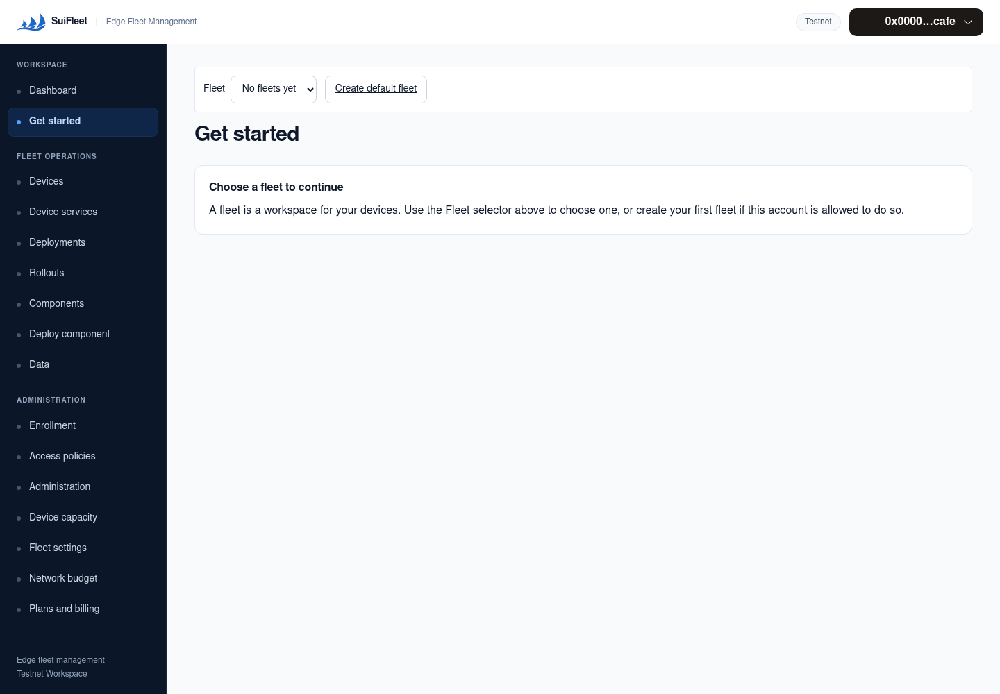
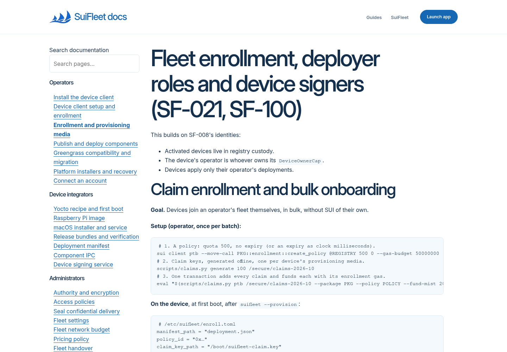
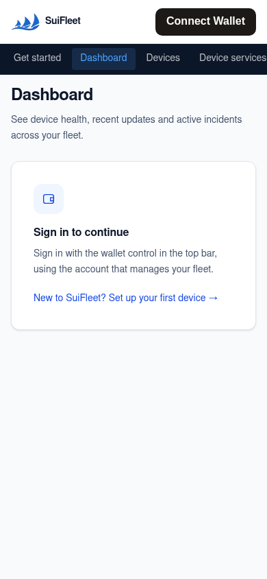

# SuiFleet customer readiness review

SuiFleet explains its core purpose well, but the first-device journey is not yet reliably self-service for a customer without blockchain knowledge. The most important fixes are account setup before fleet creation, an executable installation handoff, consistent money concepts, and customer documentation that matches the current console. Visual polish alone will not resolve those barriers.

This review was requested by the owner on 16 November 2026. Codex and actual Claude Opus 5.5 performed separate reviews of the published website, app, documentation, guides and wallet process against main `b9bb2ef6210624d732ab2de2075ea1826e5300c1`.

## Independent reviews

- [Codex review](CODEX.md): live desktop/mobile browsing, a deliberately non-signing test wallet, read-only public demo fleet browsing, all written lessons, video samples and live caption checks.
- [Claude first report](CLAUDE.md): independent website/app crawl, initial customer narrative and findings.
- [Claude completed review and corrections](CLAUDE_ADDENDUM.md): full reading of all curated docs, every app route and its major components, and lesson/source comparisons. This supersedes the first report’s incomplete coverage and recommendation to add testnet banners to marketing.
- [Evidence summary](evidence.json): dates, source revision, coverage, actual commands and explicit acceptance limits.

The owner’s direction remains binding: the marketing website should have production-oriented messaging without testnet jargon. The app must truthfully explain its evaluation environment. A neutral “Try the console” handoff and a clear app-side introduction can satisfy both. No new commercial prices, recovery guarantees or production availability are approved by this review.

## Coverage and limits

| Surface | Coverage | Evidence |
| --- | --- | --- |
| Public marketing | Home, how it works, pricing, guide, docs, security, contact and privacy; Claude also inspected film preview and 404 | Separate live desktop/mobile browser sessions and complete text |
| Public documentation | Home and all 21 curated operator, integrator and administrator pages | Live load/layout checks and full text/source review |
| Console | All 16 routes signed out; 15 non-dashboard routes with a non-signing public demo account; source of every route and major form | Live UI/read-only queries plus source inspection |
| New-account setup | Empty test account connected without signing | Reproduced fleet gate hiding Get started |
| Guides | All 10 written lessons, prerequisites, actions, outcomes, narration and captions | Compared with current controls/source; sampled video visuals |
| Captions | All 10 published videos at 390px and 1440px | Existing real-browser acceptance passed on/off, cues and media identity |
| Wallet handoff | Opened the actual Slush popup without credentials | Returned regional unavailability in this test environment |
| Signing and device execution | Not established by this review | No actual Slush/extension signing, account funding, device installation, Pi boot, mainnet or production release-custody claim |

Some pages displayed transient loading states during read-only navigation. Those observations are not proof that the underlying operation never completes. Code-only findings are marked in the independent reports. An empty test wallet or impersonated public address cannot demonstrate ownership or successful wallet acceptance.

## Prioritized implementation plan

Each row groups a customer task rather than creating one issue per wording change. Work can proceed independently unless an actual shared API or acceptance dependency is found.

| Workstream | Findings | Tracking | Expected customer outcome |
| --- | --- | --- | --- |
| First account and first fleet | Codex C01–C02; Claude A-2, A-3, A-9, A-17 | [SF-272 / #705](https://github.com/tyler-suifleet/suifleet/issues/705) | Account setup remains usable without a fleet; the customer can obtain approval fees, create a named workspace and understand capacity before registration |
| Customer documentation and installation handoff | C03–C04; A-1, A-7, A-10, A-11, A-17 | [SF-273 / #706](https://github.com/tyler-suifleet/suifleet/issues/706); release custody remains [#62](https://github.com/tyler-suifleet/suifleet/issues/62) | Public docs use current labels and complete procedures, not internal tickets, developer paths or unsupported download claims |
| Coherent written and narrated walkthrough | C07; A-4, A-5 | [SF-274 / #707](https://github.com/tyler-suifleet/suifleet/issues/707) | Optional lessons are distinguishable; private access precedes confidential publishing; desired versions and explicit rollout approvals match actual behavior |
| Understandable plans and pilot contact | C08–C09; first-report P1-3/P1-4/P1-6; A-11/A-12 | [SF-275 / #708](https://github.com/tyler-suifleet/suifleet/issues/708) | Existing prices are understandable in dollars, funding arrangements are explicit and pilot enquiries have one honest private route |
| Task-oriented console and logging setup | C06, C10, C12; A-6/A-15 and navigation/storage terminology findings | [SF-276 / #709](https://github.com/tyler-suifleet/suifleet/issues/709) | The normal library-to-device path is obvious, mobile destinations are discoverable and logs/storage prerequisites have a usable next step |
| Safe approvals and useful recovery | C11, C13; A-13/A-14/A-16 | [SF-277 / #710](https://github.com/tyler-suifleet/suifleet/issues/710) | Customer-readable feedback preserves uncertainty, credential downloads warn beforehand, and irreversible transfers have a clear recipient/resource summary |
| Compatible packaged device client | C05; A-8 | [SF-278 / #711](https://github.com/tyler-suifleet/suifleet/issues/711) | The pinned Yocto client accepts the intended evaluation profile without weakening compatibility or identity protections |
| Reliable review completion | Queue investigation below | [SF-270 / #703](https://github.com/tyler-suifleet/suifleet/issues/703) | Completed work publishes and closes correctly; obsolete review retries disappear; strict hosted-runner recovery includes authenticated main acceptance |

The audit itself is [SF-271 / #704](https://github.com/tyler-suifleet/suifleet/issues/704). These are published implementation tasks, not claims that the fixes are deployed. Claude’s self-service-blocker severity labels are retained in its report; the implementation backlog uses P1 for these customer-readiness defects. No new critical security exploit was established.

## Examples of the current barriers

### A new account loses setup guidance after connecting

The empty-account browser test shows only fleet selection and “Choose a fleet to continue.” Funding instructions are inside the setup component that this gate hides. Account setup needs to remain available while data/action isolation stays intact.

### Customer help opens with contract calls and ticket history

An integrator may need these details, but the operator first needs an executable task and its expected result. Keep deep reference available in a separate audience-appropriate section.

### Mobile navigation hides most destinations behind sideways scrolling

The layout avoids document overflow, but that does not make a sixteen-item strip discoverable. A grouped menu should expose the available tasks without requiring a user to guess the gesture.

## Target first-device journey

1. Understand the product and platform boundary without learning token mechanics.
2. Enter the console and see an app-side explanation of the evaluation environment and available account providers.
3. Follow account funding, named workspace creation and device-capacity setup in a usable order. Do not require a fleet before displaying the instructions needed to create one.
4. Choose a genuinely available installation path and provide the client with connection settings. Generate device keys on the device and keep private material out of the console and shared images.
5. Register one recognizable device. Explain which setup action is complete and which device-side action remains.
6. Publish a harmless sample or a properly protected private release. Make any access-policy prerequisite explicit before confidential publication.
7. Select the device, review the proposed change, approve once and follow confirmation through to the device’s installation result and current health.
8. Introduce groups, gradual rollouts, bulk enrollment, reporting schedules and advanced security when needed. Do not make every advanced feature look mandatory for a first pilot.

## Queue recovery performed during the review

SF-246 was locally Done at revision 12 while its published revision remained 11. The coordinator’s publication retry path covered Review but not Done. The supported `ticket publish SF-246` retry succeeded and cleared the pending mirror; no completion or approval was invented.

A separate newer CI run on the same main revision prevented the retained included-source acceptance from closing PR #617 and issue #614. Only its macOS job failed: GitHub never allocated a runner, and no test steps executed. The strict hosted-runner recognizer already handled that condition for PRs, but did not cover the authenticated current-main run. The exact failed job was retried using `gh run rerun 43931104228 --job 133523425081`; final runner/result/closure state must be verified separately. Existing security/test evidence was not bypassed.

Closed, invalidated integration PRs #687/#688 also retained stopped review retry rows. SF-270 contains bounded recovery and regression coverage for these problems. A stale row is not an active worker, and a successful local completion is not proof that GitHub publication finished.

PR #640 is not simply included in main and must not be closed by guesswork. Its already-completed domain-hosting subset and remaining implementation/acceptance requirements need individual reconciliation. Issue #684 retains a real provider-selection/partner-signup decision and adapter work; it is not silently marked Done. Physical/mainnet acceptance remains explicitly deferred in the existing acceptance tickets.

## Interpretation of legacy and current administration

The independent source review includes the legacy resource-handover path. The current customer-managed profile renders `CustomerAccess` instead: organization identity and budgets remain in place while authorized accounts change. Its cross-fleet device move already has a confirmation. The legacy claim that funds cannot be included in a resource handover must not be generalized to the newer organization-administration flow. SF-277 should improve the appropriate pre-approval summaries without replacing or weakening either authority model.

## What remains before customer acceptance

The reports and tickets establish defects and an implementation plan. They do not establish the fixes, working production billing, verified mailbox delivery, trusted downloadable releases, real wallet reputation/consent, a physical device boot, or mainnet reliability. Keep those acceptance boundaries visible while allowing the software fixes to progress.
